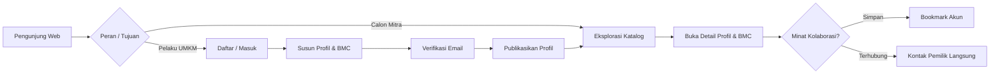

# LUMORA

**Digital Pitching + Business Discovery Platform untuk UMKM Indonesia.**

LUMORA membantu pemilik usaha mikro, kecil, dan menengah (UMKM) menyusun cerita perjalanan usaha, metrik sederhana, dan Business Model Canvas (BMC) menjadi profil digital terstruktur. Calon mitra, distributor, atau investor dapat menemukan, mempelajari, menyimpan (bookmark), dan membuka peluang kolaborasi dengan bisnis yang relevan.

> **Status Saat Ini:**
> - **Backend (Fase 1–12):** Selesai dan berjalan di platform Railway (Go 1.27 + PostgreSQL). Dilengkapi autentikasi sesi aman, soft gate verifikasi email (Resend), rate limiting token bucket in-memory, draf profil AI (Google Gemini), upload media, bookmark server-side, soft-delete arsip profil, cascade penghapusan akun, serta role dan endpoint analitik admin.
> - **Frontend (Tahap 0–8):** Selesai dan terintegrasi penuh ke API backend (Next.js 16 App Router + React 19). Seluruh data dummy/mock lokal telah dihapus. Dilengkapi autentikasi terverifikasi, route guard `/dashboard` & `/admin`, form bertahap profil usaha, upload cover/logo, draf AI terintegrasi, bookmark server-side, pengaturan akun, CMS admin overview, dan unit test Vitest.

---

## Daftar Isi

- [Tujuan Produk](#tujuan-produk)
- [Struktur Repositori](#struktur-repositori)
- [Fitur Utama](#fitur-utama)
- [Flow & Alur Pengguna](#flow--alur-pengguna)
- [Peta Route Frontend](#peta-route-frontend)
- [Teknologi & Stack](#teknologi--stack)
- [Panduan Menjalankan Proyek](#panduan-menjalankan-proyek)
- [Arsitektur Sistem](#arsitektur-sistem)
  - [Arsitektur Backend](#arsitektur-backend)
  - [Arsitektur Frontend](#arsitektur-frontend)
  - [Keamanan & Autentikasi](#keamanan--autentikasi)
  - [AI Drafting & Media](#ai-drafting--media)
- [Design System](#design-system)
- [Status Fitur & Backlog Terbuka](#status-fitur--backlog-terbuka)
- [Dokumentasi Terkait](#dokumentasi-terkait)

---

## Tujuan Produk

LUMORA menjembatani dua kebutuhan utama dalam ekosistem bisnis lokal:

### 1. Untuk Pelaku UMKM
- **Digital Storytelling:** Mengubah narasi mentah menjadi profil bisnis digital yang rapi dan menarik.
- **Milestone Usaha:** Mendokumentasikan rekam jejak pertumbuhan usaha dari tahun ke tahun.
- **Business Model Canvas (BMC):** Menyajikan sembilan blok model bisnis yang mudah ditinjau calon mitra.
- **Kemitraan Terarah:** Menjelaskan secara spesifik kebutuhan modal, distribusi, kolaborasi produk, atau supplier.
- **Bantuan AI Terukur:** Membantu penyusunan draf narasi tanpa pernah mengarang data finansial.

### 2. Untuk Calon Mitra & Investor
- **Pencarian Relevan:** Menjelajahi UMKM berdasarkan kata kunci, 5 kategori kurasi (*F&B, Retail, Jasa, Kreatif, Fashion*), dan kota/lokasi.
- **Konteks Mendalam:** Memahami latar belakang pendiri, cerita autentik, dan model bisnis, bukan sekadar ringkasan angka.
- **Bookmark Antarperangkat:** Menyimpan profil bisnis potensial langsung ke akun.
- **Jalur Kontak Langsung:** Memulai percakapan dengan pemilik bisnis melalui jalur komunikasi yang disediakan.

> [!NOTE]
> LUMORA **bukan** platform crowdfunding, payment gateway, escrow investasi, bursa efek/sekuritas, atau pengganti proses legal *due diligence*. Platform ini berfungsi sebagai discovery hub dan media kurasi profil bisnis awal.

---

## Struktur Repositori

```text
lumora/
├── backend/                  # REST API — Go 1.27 + Gin + PostgreSQL
│   ├── cmd/
│   │   ├── api/              # Entrypoint server HTTP API (:8080)
│   │   ├── migrate/          # Migrasi database goose (library)
│   │   ├── seed/             # Seeder 9 profil bisnis demo
│   │   └── provision-admin/  # CLI pembuatan akun administrator mandiri
│   ├── internal/
│   │   ├── ai/               # Provider draf AI (Google Gemini & Offline Stub)
│   │   ├── auth/             # Hashing Argon2id & generator token aman
│   │   ├── config/           # Validasi fail-fast environment variables
│   │   ├── domain/           # Entitas domain & kontrak tipe data (1:1 Frontend)
│   │   ├── email/            # Pengiriman email verifikasi (Resend HTTPS & Stub)
│   │   ├── http/
│   │   │   ├── handler/      # Handler HTTP Gin (Auth, Business, Media, AI, Admin)
│   │   │   └── middleware/   # Sesi cookie, rate limiter, log request-id, role check
│   │   ├── logging/          # Konfigurasi log terstruktur (log/slog JSON/Text)
│   │   ├── service/          # Business logic, transaksi multi-tabel, guardrail
│   │   └── store/            # Query SQL bertipe aman hasil generate sqlc
│   ├── migrations/           # File migrasi SQL goose (0001 - 0006)
│   ├── queries/              # Kueri SQL mentah untuk sqlc
│   ├── uploads/              # Direktori penyimpanan media lokal publik (git-ignored)
│   ├── Dockerfile            # Multi-stage build image produksi
│   └── docker-compose.yml    # Orkestrasi lokal (Postgres + migrate + seed + api)
│
├── frontend/                 # Next.js 16 (App Router) + React 19 + TypeScript
│   ├── app/
│   │   ├── (site)/           # Route publik (Homepage, Explore, Detail, Login, Register, Legal)
│   │   ├── dashboard/        # Workspace privat pemilik usaha (/dashboard)
│   │   ├── admin/            # CMS Administrator (/admin & /admin/login)
│   │   ├── globals.css       # Semantic tokens Tailwind 4 & typography
│   │   └── layout.tsx        # Root layout, Inter & DM Serif font, metadata global
│   ├── components/
│   │   ├── auth/             # Form login, register, dan verifikasi email
│   │   ├── business/         # BusinessCard, discovery explorer, BMC, timeline
│   │   ├── dashboard/        # Editor profil bertahap, upload media, draf AI, akun
│   │   ├── layout/           # Navbar responsif, mobile menu, footer, logo
│   │   └── ui/               # Primitif UI (Button, Card, Sheet, Table, Badge, Dialog)
│   ├── hooks/                # useBookmarks, useMobile, dll.
│   ├── lib/                  # Client API (api.ts), redirect guard, constants
│   ├── types/                # Kontrak TypeScript (business.ts, user.ts)
│   └── vitest.config.ts      # Konfigurasi pengujian unit Vitest
│
├── docs/                     # Dokumentasi arsitektur & panduan teknis
│   ├── api.md                # Kontrak resmi endpoint, envelope error, & checklist
│   ├── fases.md              # Log riwayat fase backend 1–11 & technical backlog
│   └── manual-test.md        # Panduan smoke test & runbook produksi Railway
├── farhan.md                 # Log riwayat integrasi frontend-backend Tahap 0–8
├── CODEBUDDY.md              # Petunjuk arsitektur & pedoman AI pair programmer
└── README.md                 # Dokumentasi utama proyek (file ini)
```

---

## Fitur Utama

### 1. Katalog & Discovery UMKM
- **Eksplorasi Publik:** Menampilkan seluruh profil UMKM berstatus `published`. Profil `draft` atau `archived` tidak pernah bocor ke publik.
- **Pencarian Multiaspek:** Pencarian kata kunci (`q`) mencakup nama usaha, deskripsi, kategori, dan lokasi.
- **Filter Kategori Terkurasi:** Mendukung 5 kategori resmi: *F&B, Retail, Jasa, Kreatif, Fashion*.
- **Paginasi Efisien:** Limit dan offset dinamis dengan total hitungan yang akurat.
- **Halaman Profil Komprehensif:** Cover usaha, logo, profil pendiri, cerita sejarah usaha, metrik kinerja (grafik 6 bulan), Business Model Canvas 9 blok, dan kebutuhan kemitraan.

### 2. Autentikasi & Pengelolaan Akun
- **Sesi Cookie HttpOnly:** Token sesi 32-byte acak disimpan dalam cookie `lumora_session` (`SameSite=Lax`, `Secure` di production). Tidak ada penyimpanan token rahasia di `localStorage`.
- **Argon2id Password Hashing:** Menggunakan standar kriptografi Argon2id PHC. Dilengkapi penanganan *dummy verification* saat login gagal untuk mencegah *timing-attack enumeration*.
- **Verifikasi Email:** Token 32-byte acak dengan TTL 24 jam. Database hanya menyimpan hash SHA-256 (bukan token mentah).
- **Soft-Gate Publikasi:** Pengguna belum terverifikasi tetap dapat login, mengedit draf, dan mengunggah gambar. Verifikasi email hanya diwajibkan saat melakukan publikasi profil (`POST /publish`) dan pembuatan draf AI (`POST /ai/draft-profile`).
- **Pengaturan Profil Akun:** Ubah nama akun, perbarui kata sandi (otomatis mencabut sesi perangkat lain), dan hapus akun permanen (cascade otomatis ke sesi, bookmark, profil bisnis, milestone, dan BMC).

### 3. Ruang Kerja Pemilik Usaha (`/dashboard`)
- **Daftar Profil Usaha Milik Sendiri:** Memantau semua draf dan profil yang telah dipublikasikan (`GET /businesses/mine`).
- **Editor Profil Multi-langkah:** Input identitas usaha, narasi cerita, pendiri, model BMC, dan kebutuhan mitra.
- **Upload Media Mandiri:** Unggah gambar logo dan cover usaha dengan validasi tipe byte langsung dari server.
- **Bantuan Draf Profil AI:** Mengubah cerita usaha mentah menjadi draf profil terstruktur siap sunting.
- **Manajemen Siklus Hidup:** Publikasi profil langsung ke katalog, pratinjau profil sebelum terbit, dan pengarsipan profil (*soft delete*).

### 4. Bookmark Berbasis Akun
- **Sinkronisasi Server:** Menggantikan penyimpanan lokal perangkat. Profil tersimpan terikat pada akun pengguna dan sinkron di semua perangkat.
- **Operasi Idempoten:** Penambahan (`POST`) dan penghapusan (`DELETE`) bookmark bersifat idempoten dan aman dipanggil berulang.
- **Tab Tersimpan di Dashboard:** Pemilik akun dapat meninjau dan mengelola daftar profil UMKM yang disimpan langsung dari dashboard.

### 5. CMS Administrator (`/admin`)
- **Proteksi Role Admin:** Terisolasi ketat di level database (constraint `role IN ('umkm', 'mitra', 'admin')`) dan middleware backend (`RequireAdmin()`).
- **Provisioning Mandiri CLI:** Akun admin tidak dapat dibuat melalui registrasi publik. Hanya dapat dibuat melalui utilitas CLI `cmd/provision-admin`.
- **Analitik Operasional Real-time:** Dashboard analitik menampilkan metrik pengguna (total UMKM & mitra), total profil terbit, profil belum diverifikasi, grafik tren pendaftaran 6 bulan, dan 10 profil bisnis terbaru.

---

## Flow & Alur Pengguna

### Flow Utama Platform



---

## Peta Route Frontend

| Route | Halaman | Akses | Keterangan & Proteksi |
|---|---|---|---|
| `/` | Beranda Editorial | Publik | Hero, nilai produk, featured businesses live, FAQ, dan CTA. |
| `/explore` | Katalog Discovery | Publik | Pencarian instan, filter kategori, status bookmark akun. |
| `/business/[slug]` | Detail Profil Bisnis | Publik | Tampilan profil lengkap, BMC, milestone, dan aksi bookmark. |
| `/login` | Halaman Masuk | Publik | Proteksi open-redirect (`?next=`), validasi sesi aktif. |
| `/register` | Halaman Pendaftaran | Publik | Pilihan peran UMKM atau Mitra (`?role=umkm`). |
| `/verify-email` | Konfirmasi Email | Publik (Token) | Menangkap token query dan mem-POST ke backend (mencegah prefetch scanner). |
| `/dashboard` | Workspace Pemilik | Pengguna Aktif | Proteksi sesi server-side; kelola profil, upload media, draf AI, dan akun. |
| `/admin/login` | Login Administrator | Publik | Validasi khusus akun dengan role `admin`. |
| `/admin` | CMS Admin Overview | Administrator | Proteksi sesi + `role=admin`; metrik operasional dan pertumbuhan real-time. |
| `/how-it-works` | Cara Kerja | Publik | Rewrite ke layout editorial bersama. |
| `/for-business` | Panduan UMKM | Publik | Rewrite ke layout editorial bersama. |
| `/for-partners` | Panduan Mitra | Publik | Rewrite ke layout editorial bersama. |
| `/about` | Tentang Kami | Publik | Rewrite ke layout editorial bersama. |
| `/kebijakan-privasi` | Kebijakan Privasi | Publik | Informasi kepatuhan dan privasi data pengguna. |
| `/syarat-ketentuan` | Syarat & Ketentuan | Publik | Ketentuan layanan platform. |

---

## Teknologi & Stack

### Backend
- **Bahasa & Framework:** Go 1.27, Gin Web Framework.
- **Basis Data & Driver:** PostgreSQL 16 (Lokal Docker Compose) / PostgreSQL 18.6 (Produksi Railway), driver `pgx/v5`.
- **Query & Migrasi:** `sqlc` (type-safe SQL compiler), `goose` (database migration library terintegrasi).
- **Keamanan Password:** `golang.org/x/crypto/argon2` (Argon2id PHC format).
- **Penyedia AI:** Google Gemini REST API (`gemini-3.1-flash-lite` dengan structured output schema) & Offline Deterministic Stub.
- **Penyedia Email:** Resend HTTPS API & Structured Logging Stub.
- **Observabilitas:** `log/slog` (format JSON di produksi, Text di dev) dengan pelacakan `X-Request-ID`.

### Frontend
- **Framework & Runtime:** Next.js 16 (App Router), React 19, Node.js 22 LTS.
- **Styling & Desain:** Tailwind CSS 4 (`@tailwindcss/postcss`), Lucide React icons, Motion (Framer Motion).
- **Tipografi & Aksen:** DM Serif Display (Heading Editorial), Inter (Interface & Body).
- **Validasi & Pengujian:** TypeScript 5, ESLint 9, Vitest 3.

---

## Panduan Menjalankan Proyek

### 1. Menjalankan Backend (`backend/`)

#### Cara Cepat dengan Docker (Rekomendasi)
Satu perintah untuk menjalankan PostgreSQL, migrasi database, seeder data demo, dan API server:

```bash
cd backend
docker compose up -d --build
```

Verifikasi kesehatan server:
```bash
curl http://localhost:8080/healthz
# Respons: {"status":"ok"}
```

Menghentikan container:
```bash
docker compose down        # Volume data & uploads tetap tersimpan
docker compose down -v     # Reset total database & volume
```

#### Menjalankan Manual di Mesin Host
Pastikan PostgreSQL telah aktif (misal melalui Docker Compose: `docker compose up -d postgres`).

```bash
cd backend

# Salin konfigurasi environment
cp .env.example .env

# Jalankan migrasi skema
go run ./cmd/migrate

# Masukkan 9 profil data seeder demo (idempoten)
go run ./cmd/seed

# Buat akun administrator pertama
printf 'AdminPassword123!\n' | go run ./cmd/provision-admin -name "Admin Utama" -email "admin@lumora.local"

# Nyalakan server API
go run ./cmd/api
```

> [!TIP]
> Secara default `AI_PROVIDER` disetel ke `gemini` yang membutuhkan `GEMINI_API_KEY`. Jika ingin menjalankan backend tanpa kredensial pihak ketiga, ubah di `.env`:
> ```env
> AI_PROVIDER=stub
> EMAIL_PROVIDER=stub
> ```

#### Menjalankan Pengujian Backend
```bash
# Unit test lengkap (tanpa butuh database)
go test ./... -count=1

# Integration test (menguji alur ke PostgreSQL asli, auto-cleanup)
go test -tags integration ./internal/service -run Integration -v -count=1

# Pemeriksaan format & static analysis
gofmt -l . && go vet ./...
```

---

### 2. Menjalankan Frontend (`frontend/`)

```bash
cd frontend

# Pasang dependensi
npm install

# Jalankan server pengembangan Next.js (:3000)
npm run dev

# Jalankan pemeriksaan unit test
npm run test

# Typecheck & Build produksi
npm run typecheck
npm run build
npm run start
```

---

## Arsitektur Sistem

### Alur Request Backend

Setiap request masuk melalui router utama di `cmd/api/main.go` dengan struktur layer independen:

```text
HTTP Request
     │
     ▼
[Middleware Chain]
  ├── AccessLog (Request-ID & latency)
  ├── AttachSession (Memeriksa cookie lumora_session)
  ├── RateLimiter (Katup Global -> Limiter Per-Kunci)
  └── RequireSession / RequireVerified / RequireAdmin (Role/Auth Guard)
     │
     ▼
[Handler Layer] (`internal/http/handler`)
  └── Parsing HTTP JSON, validasi format, ekstraksi parameter
     │
     ▼
[Service Layer] (`internal/service`)
  └── Logika bisnis, transaksi atomik (`Transactor`), sanitasi draf
     │
     ▼
[Store Layer] (`internal/store`)
  └── Eksekusi kueri type-safe via sqlc ke PostgreSQL
```

### Format Amplop Error Bersama
Seluruh response error backend mengikuti satu standar seragam:
```json
{
  "error": {
    "code": "invalid_credentials",
    "message": "Email atau kata sandi salah."
  }
}
```
Standar ini dipertahankan secara sinkron di seluruh handler backend dan diproses terstruktur oleh `frontend/lib/api.ts`.

---

## Design System

Token desain didefinisikan secara semantik di `frontend/app/globals.css`:

| Token | Warna | Kelas Tailwind | Penggunaan |
|---|---|---|---|
| `--lumora-forest` | `#123f32` | `bg-forest`, `text-forest` | Warna utama, navigasi, dan tombol primer |
| `--lumora-deep-forest` | `#0b3027` | `bg-deep-forest` | State hover dan footer gelap |
| `--lumora-lime` | `#b7df68` | `bg-lime`, `text-forest` | Aksen visual, badge, dan highlight fitur |
| `--lumora-ivory` | `#f5f2e9` | `bg-ivory` | Latar belakang halaman publik |
| `--lumora-surface` | `#fbfaf6` | `bg-surface` | Permukaan kartu card dan elemen form |
| `--lumora-border` | `#d8d8cf` | `border-line` | Garis pembatas kartu dan kontainer |
| `--lumora-text` | `#14382f` | `text-ink` | Teks judul dan tipografi utama |
| `--lumora-muted` | `#66736d` | `text-muted` | Teks sekunder, label, dan deskripsi |

---

## Status Fitur & Backlog Terbuka

### ✅ Fitur yang Telah Berfungsi Penuh
1. **Discovery Publik:** Katalog live, pencarian kata kunci, filter kategori, detail slug dinamis, visualisasi BMC dan milestone.
2. **Sistem Sesi & Autentikasi:** Register, login anti-timing oracle, logout, proteksi sesi `httpOnly`.
3. **Soft-Gate Email Verification:** Token verifikasi aman SHA-256 via Resend HTTPS API.
4. **CRUD Profil Usaha:** Buat draft, perbarui parsial (PATCH), publish dengan guardrail kelengkapan data.
5. **Bookmark Server-Side:** Tersimpan per akun pengguna di database PostgreSQL.
6. **Upload Media:** Pemeriksaan tipe konten berbasis sniffing byte file dan penyimpanan UUID lokal.
7. **Draf Profil AI:** Ekstraksi terstruktur Google Gemini dengan pelindung anti-hallucination data finansial.
8. **Pengelolaan Akun:** Ganti nama, ganti kata sandi (logout perangkat lain), dan hapus akun (cascade).
9. **CMS Admin Overview:** Role constraint di database, otorisasi `RequireAdmin`, provisioning CLI mandiri, dan ringkasan metrik dashboard.

### ⏳ Backlog & Keterbatasan yang Masih Terbuka
- **Alur Lupa / Reset Kata Sandi:** Belum tersedia alur token reset sekali pakai via email.
- **Pemulihan Profil Arsip (Unarchive):** Operasi `DELETE` mengarsipkan profil bisnis (*soft-delete*); pemulihan saat ini memerlukan intervensi database langsung.
- **Verifikasi Domain Resend:** Domain default `onboarding@resend.dev` hanya mengirim ke email pemilik akun Resend. Pengiriman ke publik memerlukan verifikasi domain operator di dashboard Resend.
- **Skalabilitas Rate Limiter:** State rate limit saat ini disimpan *in-memory* (didesain untuk *single instance* Railway). Perlu migrasi ke Redis bila backend diperluas menjadi multi-replika.
- **E2E Testing:** Pengujian saat ini mencakup unit test backend, integration test DB, dan unit test Vitest di frontend; pengujian end-to-end (Playwright) berada pada agenda berikutnya.

---

## Dokumentasi Terkait

- [Kontrak Resmi API (`docs/api.md`)](file:///d:/laragon/www/lumora-next/docs/api.md) — Daftar lengkap endpoint, struktur request/response, dan daftar kode error.
- [Riwayat Fase Backend (`docs/fases.md`)](file:///d:/laragon/www/lumora-next/docs/fases.md) — Catatan arsitektur dan kronologi pengembangan backend fase 1–11.
- [Riwayat Integrasi Frontend (`farhan.md`)](file:///d:/laragon/www/lumora-next/farhan.md) — Log tahapan integrasi autentikasi, dashboard, dan CMS admin tahap 0–8.
- [Panduan Smoke Test & Runbook (`docs/manual-test.md`)](file:///d:/laragon/www/lumora-next/docs/manual-test.md) — Langkah pengujian manual lokal dan runbook produksi Railway.
- [Pedoman AI Coding (`CODEBUDDY.md`)](file:///d:/laragon/www/lumora-next/CODEBUDDY.md) — Konvensi arsitektur dan batasan teknis untuk agen pengembang.
